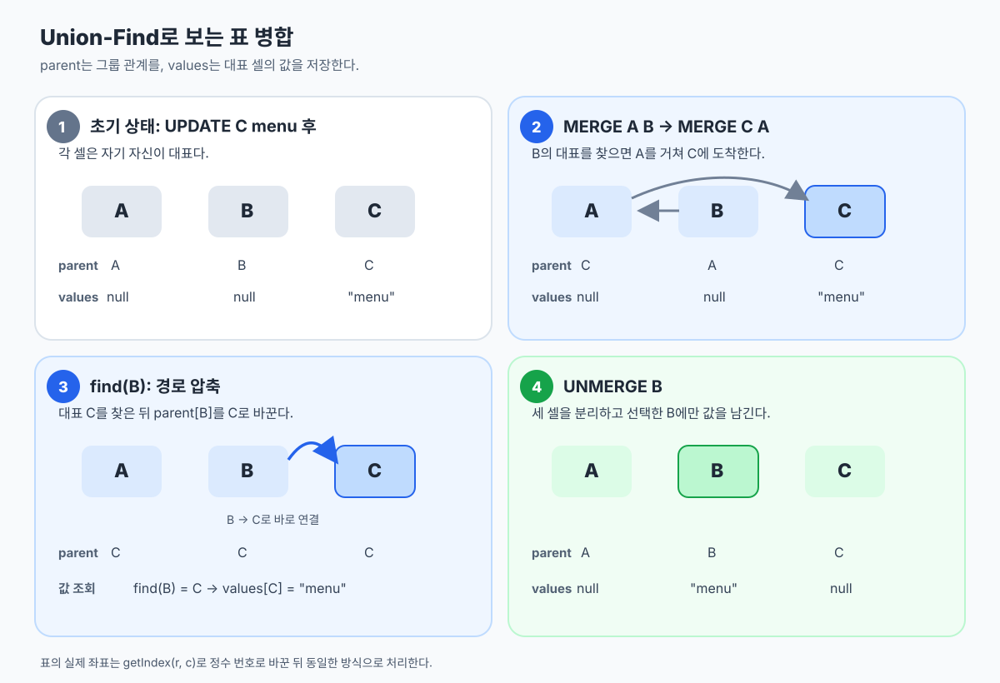

# 표 병합 (프로그래머스 Lv.3)

- 문제 링크: https://school.programmers.co.kr/learn/courses/30/lessons/150366

## 사용 알고리즘 / 자료구조

- Union-Find

## 1. 문제 접근

### 첫 번째 접근: 2차원 배열과 Map

처음에는 `String[][] shell`에 각 셀의 값을 저장하고, `Map<String, List<int[]>>`에 같은 값을 가진 셀의 좌표를 모아 병합 관계를 관리하려고 했다. `MERGE`에서 두 좌표를 리스트에 추가하고, `UNMERGE`에서 리스트에 든 좌표의 값을 비우는 방식이었다.

하지만 **값이 같은 것과 병합된 것은 다르다.** 예를 들어 `(1, 1)`과 `(5, 5)`가 모두 `"menu"`여도 별개의 셀일 수 있다. 값을 Map의 키로 삼으면 두 셀을 같은 병합 그룹으로 잘못 묶는다. 이미 병합된 그룹끼리 다시 병합될 때 구성원 전체를 관리하기도 어렵다.

### 두 번째 접근: Union-Find

각 좌표를 하나의 번호로 바꾸고, `parent` 배열로 **병합 관계**를 관리한다. 그룹의 값은 대표 셀의 `values`에만 저장한다.

```java
private int getIndex(int r, int c) {
    return r * SIZE + c;
}
```

`SIZE`가 51이므로 `(1, 1)`은 52, `(1, 2)`는 53, `(2, 1)`은 103이 된다. 처음에는 각 셀이 독립된 그룹이므로 `parent[i] = i`로 초기화한다. `String[] values`의 기본값인 `null`은 빈 셀을 뜻한다.

### 그림으로 보는 `parent`, `find`, `values`

아래 그림은 세 셀 A, B, C를 병합하는 예시다. C에 `"menu"`를 입력한 뒤 A와 B를 병합하고, 다시 C와 A를 병합한다. 그러면 B에서 대표 C까지 이어지는 부모 관계가 생긴다. `find(B)`는 C를 찾고, 경로 압축으로 B의 부모를 C로 바꾼다. 이후 `UNMERGE B`를 실행하면 세 셀이 분리되고, 선택한 B만 기존 값 `"menu"`를 갖는다.



그림의 A·B·C는 설명을 위한 이름이다. 실제 코드에서는 각 셀을 `(r, c)`에서 변환한 정수 번호로 다룬다.

### 명령어 처리 흐름

| 명령 | 처리 흐름 |
| --- | --- |
| `UPDATE r c value` | 좌표를 번호로 변환 → `find`로 대표 찾기 → 대표의 값 변경 |
| `UPDATE value1 value2` | 모든 대표 셀을 확인 → 값이 `value1`이면 `value2`로 변경 |
| `MERGE` | 두 대표 찾기 → 첫 번째 셀의 값을 우선해 유지할 값 결정 → 대표끼리 연결 |
| `UNMERGE` | 대표와 기존 값 저장 → 구성원 전부 수집 → 모두 분리 → 선택한 셀에만 값 복원 |
| `PRINT` | 대표 찾기 → 대표 값이 `null`이면 `"EMPTY"` 출력 |

`MERGE`에서는 두 셀이 이미 같은 그룹이면 아무것도 하지 않는다. 두 그룹이 모두 값을 가졌다면 첫 번째로 지정한 셀의 그룹 값을 유지한다.

`UNMERGE`에서는 **구성원을 찾는 단계와 부모를 바꾸는 단계를 분리**한다. 순회하면서 곧바로 `parent`를 바꾸면 아직 확인하지 않은 셀의 기존 대표를 찾는 데 영향을 줄 수 있기 때문이다. 해제 전 값을 저장해두고, 마지막에 명령에서 선택한 좌표에만 복원한다.

## 2. 문제 코드

```java
import java.util.*;

class Solution {
    private static final int SIZE = 51;
    private static final int CELL_COUNT = SIZE * SIZE;

    private final int[] parent = new int[CELL_COUNT];
    private final String[] values = new String[CELL_COUNT];
    private final List<String> result = new ArrayList<>();

    public String[] solution(String[] commands) {
        init();

        for (String cmd : commands) {
            divideCommand(cmd);
        }

        return result.toArray(new String[0]);
    }

    private void init() {
        for (int i = 0; i < CELL_COUNT; i++) {
            parent[i] = i;
        }
    }

    private int getIndex(int r, int c) {
        return r * SIZE + c;
    }

    void divideCommand(String command) {
        String[] cmd = command.split(" ");

        switch (cmd[0]) {
            case "UPDATE": {
                if (cmd.length == 4) {
                    int r = Integer.parseInt(cmd[1]);
                    int c = Integer.parseInt(cmd[2]);
                    String value = cmd[3];
                    updateShell(r, c, value);
                } else {
                    String value1 = cmd[1];
                    String value2 = cmd[2];
                    updateValue(value1, value2);
                }
                break;
            }
            case "MERGE": {
                int r1 = Integer.parseInt(cmd[1]);
                int c1 = Integer.parseInt(cmd[2]);
                int r2 = Integer.parseInt(cmd[3]);
                int c2 = Integer.parseInt(cmd[4]);
                merge(r1, c1, r2, c2);
                break;
            }
            case "UNMERGE": {
                int r = Integer.parseInt(cmd[1]);
                int c = Integer.parseInt(cmd[2]);
                unMerge(r, c);
                break;
            }
            case "PRINT": {
                int r = Integer.parseInt(cmd[1]);
                int c = Integer.parseInt(cmd[2]);
                print(r, c);
                break;
            }
        }
    }

    void updateShell(int r, int c, String value) {
        int num = getIndex(r, c);
        int root = find(num);
        values[root] = value;
    }

    void updateValue(String value1, String value2) {
        for (int i = 0; i < CELL_COUNT; i++) {
            if (parent[i] == i && value1.equals(values[i])) {
                values[i] = value2;
            }
        }
    }

    void merge(int r1, int c1, int r2, int c2) {
        int num1 = getIndex(r1, c1);
        int num2 = getIndex(r2, c2);

        int root1 = find(num1);
        int root2 = find(num2);

        if (root1 == root2) return;

        String mergedValue;
        if (values[root1] != null) {
            mergedValue = values[root1];
        } else {
            mergedValue = values[root2];
        }

        parent[root2] = root1;
        values[root1] = mergedValue;
        values[root2] = null;
    }

    void unMerge(int r, int c) {
        int num = getIndex(r, c);
        int root = find(num);
        String saved = values[root];

        List<Integer> list = new ArrayList<>();
        for (int i = 0; i < CELL_COUNT; i++) {
            if (root == find(i)) {
                list.add(i);
            }
        }

        for (int n : list) {
            parent[n] = n;
            values[n] = null;
        }

        values[num] = saved;
    }

    void print(int r, int c) {
        int num = getIndex(r, c);
        int root = find(num);
        if (values[root] != null) result.add(values[root]);
        else result.add("EMPTY");
    }

    int find(int x) {
        if (parent[x] == x) {
            return x;
        }

        return parent[x] = find(parent[x]);
    }
}
```

## 3. 새롭게 배운 내용

### Union-Find 기본 개념

Union-Find는 **여러 원소가 같은 그룹에 속하는지** 관리하는 자료구조다. 서로 겹치지 않는 그룹들을 다루기 때문에 *분리 집합(Disjoint Set)*이라고도 부른다.

각 원소는 `parent` 배열에 자신의 부모 번호를 저장한다. 부모를 계속 따라가다가 자기 자신을 부모로 가진 원소를 만나면 그 원소가 그룹의 **대표(root)**다.

```text
parent[A] = A       A는 자기 그룹의 대표
parent[B] = A       B는 A가 대표인 그룹에 속함
parent[C] = A       C도 같은 그룹에 속함
```

기본 연산은 두 가지다.

1. `find(x)`: `x`의 부모를 따라가 그룹의 대표를 찾는다. `find(A) == find(B)`라면 A와 B는 같은 그룹이다.
2. `union(a, b)`: 두 원소의 대표를 각각 찾은 뒤, 한 대표의 부모를 다른 대표로 바꿔 두 그룹을 합친다.

처음에는 모든 셀이 독립적인 그룹이므로 `parent[i] = i`로 초기화한다. 이 문제의 `MERGE`가 `union`에 해당하고, `UPDATE`와 `PRINT`는 `find`로 대표를 찾아 그룹의 값에 접근한다.

일반적인 Union-Find의 기본 연산은 그룹 합치기와 대표 찾기다. 이 문제의 `UNMERGE`는 추가 요구사항이므로 같은 대표를 가진 셀을 모두 찾아 각 셀의 부모를 자기 자신으로 되돌리는 방식으로 구현했다.

### 대표 셀과 경로 압축

Union-Find는 같은 그룹의 원소들이 공통 대표를 찾도록 하는 자료구조다. `find(x)`는 부모를 따라 대표를 찾는다.

```java
return parent[x] = find(parent[x]);
```

이 코드는 찾은 대표를 `parent[x]`에 바로 저장한다. 예를 들어 `B → A → C`였다면 `find(B)` 후 `B → C`가 된다. 다음 조회에서 경유할 노드가 줄어드는 **경로 압축**이다.

### 값과 그룹은 별개의 정보

값이 같아도 병합되지 않은 셀은 서로 다른 그룹이다. `parent`가 그룹을 나타내고, `values`는 대표의 값을 나타낸다. 병합된 셀의 값을 읽거나 바꿀 때는 항상 `find()`로 대표를 먼저 찾는다.

### `UNMERGE`에서 조회 후 변경

같은 그룹인지 확인하는 데 `parent`를 사용하므로, 구성원을 찾는 도중 부모를 초기화하지 않는다. 먼저 `List<Integer>`에 모두 모은 다음 그룹을 분리한다. 그룹의 값도 미리 저장해두어 선택한 셀에만 복원한다.

## 4. 시간복잡도 / 공간복잡도

셀 수를 `N`(`51 × 51`), 명령 수를 `Q`라고 하자. 이 코드는 경로 압축을 사용하지만 그룹 크기·랭크 기준 병합은 사용하지 않는다. 따라서 `find()` 한 번의 최악 시간은 `O(N)`이며, 여러 번 호출하면 경로가 짧아진다.

| 명령 | 최악 시간복잡도 |
| --- | --- |
| `UPDATE r c value`, `MERGE`, `PRINT` | `O(N)` — `find()` 호출 |
| `UPDATE value1 value2` | `O(N)` — 전체 배열 순회 |
| `UNMERGE` | `O(N²)` — 모든 셀에 `find()` 호출 |

전체 공간복잡도는 `parent`, `values`, 결과 목록, `UNMERGE`의 임시 목록을 포함해 `O(N + Q)`이다. 실제로는 셀이 최대 2,500개, 명령이 최대 1,000개이므로 `UNMERGE`의 전체 셀 확인이 가능하다.

## 5. 엣지 케이스

- 같은 셀이나 이미 같은 그룹의 셀을 병합하면 아무 작업도 하지 않는다.
- 서로 다른 두 그룹에 값이 있다면 명령의 첫 번째 셀이 속한 그룹의 값을 유지한다.
- 첫 번째 그룹이 비어 있다면 두 번째 그룹의 값을 유지하고, 둘 다 비었다면 빈 상태로 병합한다.
- 병합된 그룹의 어느 셀을 `UPDATE`하거나 `PRINT`해도 같은 대표의 값에 접근한다.
- `UNMERGE` 후에는 선택한 셀만 이전 값을 유지한다. 선택한 셀이 기존 대표가 아니어도 같다.
- 같은 문자열을 가진 독립적인 두 셀은 서로 다른 그룹으로 남아야 한다.

## 6. 한줄평

셀의 값과 병합 관계를 분리해서 생각하니, 복잡해 보이던 표의 동작을 대표 셀 중심으로 정리할 수 있었다.

## 7. 더 나은 풀이와 코드 개선

현재 풀이는 작은 표를 활용해 `UNMERGE`에서 모든 셀을 확인한다. 구현이 단순하며 문제의 입력 크기에서는 충분한 방법이다.

- `updateShell()`은 그룹의 값을 바꾸므로 `updateCell()`처럼 역할이 드러나는 이름을 사용할 수 있다.
- `divideCommand()`는 명령을 분리할 뿐 아니라 실행하므로 `executeCommand()`가 더 정확하다.
- `num`, `list`, `saved`를 `cellIndex`, `mergedCells`, `savedValue`처럼 바꾸면 `UNMERGE` 흐름을 읽기 쉽다.
- 같은 `Solution` 객체에서 `solution()`을 여러 번 호출할 가능성까지 고려한다면, `init()`에서 `values`와 `result`도 초기화하면 이전 실행 상태가 남지 않는다.

## 8. 비슷한 문제에 적용하기

### 언제 Union-Find를 떠올릴까?

문제에서 **원소들을 그룹으로 합치고**, 이후에 **두 원소가 같은 그룹인지** 여러 번 묻는다면 Union-Find를 떠올릴 수 있다. 원소 하나하나의 연결 관계를 매번 다시 탐색하는 대신, 각 원소의 대표만 비교하면 된다.

| 문제에서 보이는 상황 | Union-Find로 하는 일 |
| --- | --- |
| 친구 관계를 연결하고 두 사람이 같은 무리인지 확인 | 두 사람의 그룹을 합치고 대표를 비교 |
| 네트워크의 두 컴퓨터가 연결되어 있는지 확인 | 연결된 컴퓨터를 같은 그룹으로 관리 |
| 간선을 추가할 때 사이클이 생기는지 확인 | 간선 양 끝의 대표가 이미 같다면 사이클 발생 |
| 여러 셀을 병합하고 어느 셀로 접근해도 같은 값을 읽기 | 셀을 합친 뒤 대표에 저장된 값 조회 |

이 문제에서는 `MERGE`가 그룹을 합치는 연산이고, `UPDATE`와 `PRINT`가 `find()`로 대표를 찾은 뒤 그룹의 값에 접근하는 연산이다.

### 이 문제에서 따로 생각해야 했던 점

일반적인 Union-Find는 그룹을 **합치고 조회하는 것**에 적합하다. 한 번 합친 그룹에서 일부 원소를 다시 떼어내는 기능은 기본 연산에 없다. 따라서 `UNMERGE`가 있는 이 문제에서는 그룹의 구성원을 모두 찾아 부모를 초기화하는 처리가 필요했다.

또한 그룹의 대표 번호와 그룹의 값은 역할이 다르다. 두 그룹의 대표를 연결하기 **전에** 문제의 우선순위에 따라 남길 값을 결정해야 한다. 이 문제는 두 그룹에 값이 있으면 첫 번째로 지정한 셀의 값을 선택한다. 대표를 어느 쪽으로 정할지는 구현 방법이지만, **남길 값은 명령에서 지정한 셀의 순서**를 따라야 한다.

문제를 볼 때 다음 두 질문을 먼저 해보면 도움이 된다.

1. 필요한 작업이 그룹 합치기와 같은 그룹인지 확인하기인가?
2. 그룹을 분리해야 한다면, 구성원을 어떻게 찾아 다시 독립시킬 것인가?
