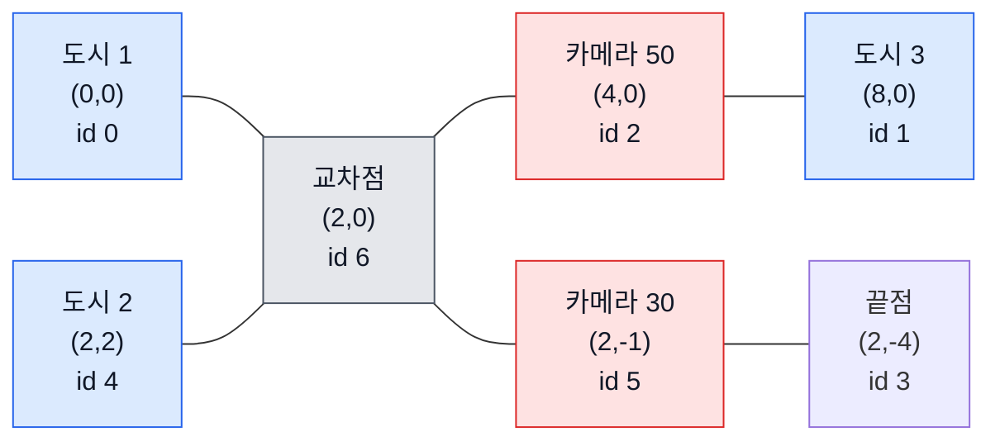

# 최고 속도 (프로그래머스 Lv.3)

- 문제 링크: https://school.programmers.co.kr/learn/courses/30/lessons/468376

## 0. 문제 요약

도로는 가로 또는 세로 선분이고, 서로 만나거나 교차하는 지점에서 다른 도로로 이동할 수 있다. 각 도로의 정중앙에는 제한 속도가 정해진 카메라가 있다. 1번 도시에서 출발해 다른 도시마다 **일정한 속도로 도착할 수 있는 최고 속도**를 구한다. 한 경로에서는 지나간 카메라의 제한 속도 중 가장 낮은 값을 따라야 한다. 카메라를 지나지 않는 경로가 있다면 해당 도시의 답은 `0`이다.

도로는 최대 1,000개, 도시는 최대 100개이고 좌표의 절댓값은 최대 `10⁹`이다.

## 사용 알고리즘 / 핵심 기법 / 자료구조

| 구분 | 이 문제에서의 역할 |
| --- | --- |
| 알고리즘: 최대 병목 경로 탐색 | 경로마다 가장 낮은 제한 속도를 구하고, 그 값이 가장 큰 경로를 선택한다. 우선순위 큐를 이용한 다익스트라식 탐색이다. |
| 핵심 기법: 필요한 좌표만 그래프로 만들기 | 도로의 끝점·교차점·도시·카메라를 정점으로 두고, 같은 도로 위의 이웃한 정점만 연결한다. |
| 자료구조: `HashMap`, 인접 리스트, 우선순위 큐 | 좌표별 정점 번호, 정점 간 연결, 탐색할 경로의 우선순위를 각각 관리한다. |

## 1. 문제 접근

처음에는 도로 정보를 행렬에 표시하고 DFS로 갈 수 있는 길을 따라가려고 했다. 하지만 좌표가 `-10⁹`부터 `10⁹`까지 가능하므로 좌표마다 칸을 만드는 행렬은 사용할 수 없다. 또한 DFS로 가능한 경로를 모두 확인하면 순환하는 도로와 많은 경로를 처리해야 한다.

그래서 **실제로 이동이 달라지거나 속도 제한이 생기는 위치**만 기록했다.

```text
도로 시작점 ─ 교차점 ─ 카메라 ─ 도시 ─ 도로 끝점
                 │
              다른 도로
```

이 코드에서 **정점은 도로 조각이 아니라 좌표상의 지점**이다. 도로 조각은 정점 사이의 연결로 표현한다. 다른 풀이에서는 카메라나 도시를 기준으로 잘린 도로 조각 자체를 정점으로 둘 수도 있지만, 아래 코드는 지점 정점 방식이다.

가로 도로와 세로 도로가 만나는 후보 좌표는 `(세로 도로의 x, 가로 도로의 y)`다. 그 좌표가 두 도로의 범위에 모두 포함되면 교차점으로 등록한다. 같은 방향의 도로가 끝점에서 만나면, 이미 등록한 끝점의 정점 번호를 공유하므로 따로 검사하지 않는다. 모든 지점을 모은 뒤 **각 도로 안에서 좌표 순으로 정렬**하고 바로 이웃한 지점끼리 연결한다.

그래프가 만들어지면 경로의 속도를 갱신한다. 현재까지 가능한 속도가 `speed`이고 다음 지점의 카메라 제한이 `limit[next]`라면, 다음 지점까지 가능한 속도는 `min(speed, limit[next])`다. 같은 지점에 도착하는 여러 경로 중 이 값이 가장 큰 경로를 남기고, 우선순위 큐로 큰 속도부터 탐색한다.

## 2. 문제 코드

```java
import java.util.*;

class Solution {
    // INF는 아직 어떤 카메라도 지나지 않아 속도 제한이 없는 상태다.
    private static final int INF = Integer.MAX_VALUE;
    // 좌표 범위 [-10^9, 10^9]를 음수 없는 범위로 옮길 때 사용한다.
    private static final long OFFSET = 1_000_000_000L;

    // 좌표를 인코딩한 값 -> 그래프 정점 번호
    private Map<Long, Integer> ids;
    // points.get(i): i번 도로 위에 있는 중요한 지점들의 좌표 키
    private List<List<Long>> points;

    public int[] solution(int[][] city, int[][] road) {
        ids = new HashMap<>();
        points = new ArrayList<>();

        for (int i = 0; i < road.length; i++) {
            points.add(new ArrayList<>());
        }

        // 도로 자체의 양 끝과 카메라 위치를 등록한다.
        for (int i = 0; i < road.length; i++) {
            int[] r = road[i];

            addPoint(i, r[0], r[1]);
            addPoint(i, r[2], r[3]);
            addPoint(
                i,
                ((long) r[0] + r[2]) / 2,
                ((long) r[1] + r[3]) / 2
            );
        }

        // 가로·세로 도로가 만나면 교차점을 양쪽 도로에 등록한다.
        for (int i = 0; i < road.length; i++) {
            for (int j = i + 1; j < road.length; j++) {
                addIntersection(i, j, road);
            }
        }

        // 도시가 여러 도로 위에 있다면 그 도로들에 모두 등록한다.
        for (int[] c : city) {
            for (int i = 0; i < road.length; i++) {
                if (contains(road[i], c[0], c[1])) {
                    addPoint(i, c[0], c[1]);
                }
            }
        }

        // limit[node]: 해당 지점에 있는 카메라의 제한 속도.
        // 카메라가 없으면 INF, 여러 개가 겹치면 가장 낮은 값이다.
        int[] limit = new int[ids.size()];
        Arrays.fill(limit, INF);

        for (int[] r : road) {
            long x = ((long) r[0] + r[2]) / 2;
            long y = ((long) r[1] + r[3]) / 2;
            int node = ids.get(key(x, y));

            limit[node] = Math.min(limit[node], r[4]);
        }

        // graph.get(node): 이 지점에서 바로 이동할 수 있는 이웃 지점들
        List<List<Integer>> graph = new ArrayList<>();
        for (int i = 0; i < ids.size(); i++) {
            graph.add(new ArrayList<>());
        }

        for (List<Long> line : points) {
            // 키는 x를 먼저, y를 다음으로 비교한다.
            // 가로 도로에서는 x순, 세로 도로에서는 y순이 된다.
            Collections.sort(line);

            long prev = -1;
            for (long current : line) {
                if (current == prev) continue; // 같은 도로에 중복 등록된 점

                if (prev != -1) {
                    int a = ids.get(prev);
                    int b = ids.get(current);

                    // 도로 위에서 바로 이웃한 두 점은 양방향으로 이동한다.
                    graph.get(a).add(b);
                    graph.get(b).add(a);
                }
                prev = current;
            }
        }

        // best[node]: 1번 도시에서 이 지점까지 가능한 최고 속도
        int[] best = new int[ids.size()];
        Arrays.fill(best, -1);

        int start = ids.get(key(city[0][0], city[0][1]));
        best[start] = INF;

        // 큐 원소는 {정점 번호, 그 지점까지 가능한 속도}.
        // 속도가 큰 후보를 먼저 꺼낸다.
        PriorityQueue<int[]> pq = new PriorityQueue<>(
            (a, b) -> Integer.compare(b[1], a[1])
        );
        pq.offer(new int[]{start, INF});

        while (!pq.isEmpty()) {
            int[] cur = pq.poll();
            int node = cur[0];
            int speed = cur[1];

            // 나중에 더 좋은 경로가 발견되어 쓸모없어진 후보는 건너뛴다.
            if (speed < best[node]) continue;

            for (int next : graph.get(node)) {
                // 카메라가 없다면 limit[next]는 INF여서 속도가 유지된다.
                int nextSpeed = Math.min(speed, limit[next]);

                if (nextSpeed > best[next]) {
                    best[next] = nextSpeed;
                    pq.offer(new int[]{next, nextSpeed});
                }
            }
        }

        int[] answer = new int[city.length - 1];
        for (int i = 1; i < city.length; i++) {
            int node = ids.get(key(city[i][0], city[i][1]));
            int speed = best[node];

            // INF는 카메라를 만나지 않고 도착한 경로이므로 문제 규칙상 0이다.
            answer[i - 1] = speed == INF ? 0 : speed;
        }
        return answer;
    }

    // 좌표 (x, y)를 중복 없는 하나의 long 키로 만든다.
    private long key(long x, long y) {
        return ((x + OFFSET) << 31) | (y + OFFSET);
    }

    // roadIndex는 도로 번호다. points.get(roadIndex)는 그 도로 위 지점 목록이다.
    private void addPoint(int roadIndex, long x, long y) {
        long point = key(x, y); // point는 정점 번호가 아닌 좌표 키

        if (!ids.containsKey(point)) {
            ids.put(point, ids.size()); // ids.get(point)가 정점 번호
        }
        // 이미 ids에 있는 점이어도, 이 도로가 그 점을 지난다는 사실은 기록한다.
        points.get(roadIndex).add(point);
    }

    // (x, y)가 도로 r의 선분 위에 있는지 확인한다.
    private boolean contains(int[] r, long x, long y) {
        return r[0] <= x && x <= r[2]
            && r[1] <= y && y <= r[3]
            && (r[0] == r[2] ? x == r[0] : y == r[1]);
    }

    // 가로 도로와 세로 도로가 교차하는 지점을 찾아 양쪽에 등록한다.
    private void addIntersection(int i, int j, int[][] road) {
        int[] a = road[i];
        int[] b = road[j];

        boolean aHorizontal = a[1] == a[3];
        boolean bHorizontal = b[1] == b[3];

        // 같은 방향 도로의 끝점은 처음 addPoint()에서 이미 등록했다.
        if (aHorizontal == bHorizontal) return;

        int[] h = aHorizontal ? a : b;
        int[] v = aHorizontal ? b : a;

        // 교차점 후보 = (세로 도로의 x, 가로 도로의 y)
        long x = v[0];
        long y = h[1];

        if (contains(h, x, y) && contains(v, x, y)) {
            addPoint(i, x, y);
            addPoint(j, x, y);
        }
    }
}
```

### 변수 역할

| 변수 | 의미 |
| --- | --- |
| `INF` | 아직 카메라를 지나지 않아 속도 제한이 없음을 나타낸다. |
| `OFFSET` | 음수 좌표도 `key()`에서 사용할 수 있도록 좌표를 양수 범위로 옮긴다. |
| `point` | `key(x, y)`가 만든 `long` 좌표 키다. 정점 번호가 아니다. |
| `ids` | `좌표 키 → 정점 번호`를 저장한다. `ids.get(point)`가 정점 번호다. |
| `roadIndex` | `addPoint()`에 전달한 도로의 인덱스다. `city`의 인덱스가 아니다. |
| `points` | 도로마다 그 위에 있는 지점의 **좌표 키**를 모은다. 정점 번호는 저장하지 않는다. |
| `limit[node]` | 해당 지점에 카메라가 없다면 `INF`, 있다면 그곳의 최소 제한 속도다. |
| `graph` | 각 지점에서 도로를 따라 바로 이동할 수 있는 이웃 지점 목록이다. |
| `prev`, `current` | 같은 도로의 지점을 정렬한 뒤, 이웃한 두 지점을 연결할 때 사용한다. |
| `best[node]` | 1번 도시에서 그 지점까지 가능한 경로들 중 가장 높은 속도다. |
| `pq` | 아직 확장할 경로를 가능한 속도가 높은 순서로 꺼낸다. |

### 함수와 코드 구현 흐름

| 순서 | 함수·코드 | 역할 |
| --- | --- | --- |
| 1 | `key()` | `(x, y)`를 하나의 `long`으로 바꿔 같은 좌표인지 비교한다. |
| 2 | `addPoint(roadIndex, x, y)` | 좌표에 정점 번호를 부여하고, `points.get(roadIndex)`에 좌표 키를 추가한다. |
| 3 | `addIntersection()` + `contains()` | 도로 두 개가 실제로 만나는지 확인해 교차점을 두 도로에 등록한다. |
| 4 | `solution()`의 도시 등록 | 도시가 놓인 모든 도로에 해당 좌표를 등록한다. |
| 5 | `solution()`의 `limit` 계산 | 각 카메라의 제한 속도를 정점에 기록하고, 겹치면 최솟값을 남긴다. |
| 6 | `solution()`의 `Collections.sort()` | 각 도로의 지점을 순서대로 놓고 이웃한 지점끼리 연결한다. |
| 7 | `solution()`의 우선순위 큐 | 현재 속도의 최솟값을 다음 카메라까지 갱신하며 가장 좋은 경로를 찾는다. |
| 8 | `solution()`의 결과 변환 | 카메라 없는 경로를 나타내는 `INF`를 문제의 반환값 `0`으로 바꾼다. |

### 작은 예시로 변수 값 따라가기

도로 두 개와 도시 세 개만 놓고 코드가 어떤 값을 만드는지 따라가 보자.

```text
city = [[0,0], [2,2], [8,0]]
road = [[0,0,8,0,50], [2,-4,2,2,30]]
```



**① `addPoint()`와 `addIntersection()`: `ids`에 번호 붙이기**

코드는 먼저 0번 도로의 양 끝과 카메라, 다음으로 1번 도로의 양 끝과 카메라를 등록한다. 이후 도로 쌍 `i=0`, `j=1`을 검사해 교차점 `(2,0)`을 찾는다. 이 점은 가로 도로의 `0 ≤ x ≤ 8`, 세로 도로의 `-4 ≤ y ≤ 2`를 모두 만족한다.

| 정점 번호 | 실제 좌표 | 역할 | 처음 등록되는 때 |
| ---: | --- | --- | --- |
| `0` | `(0,0)` | 도시 1, 0번 도로 시작점 | 0번 도로 끝점 등록 |
| `1` | `(8,0)` | 도시 3, 0번 도로 끝점 | 0번 도로 끝점 등록 |
| `2` | `(4,0)` | 제한 속도 50 카메라 | 0번 도로 중점 등록 |
| `3` | `(2,-4)` | 1번 도로 시작점 | 1번 도로 끝점 등록 |
| `4` | `(2,2)` | 도시 2, 1번 도로 끝점 | 1번 도로 끝점 등록 |
| `5` | `(2,-1)` | 제한 속도 30 카메라 | 1번 도로 중점 등록 |
| `6` | `(2,0)` | 두 도로의 교차점 | `addIntersection(0, 1, road)` |

**`point`는 정점 번호가 아니다.** `(x,y)`를 변환한 `long` 좌표 키다. `ids`가 이 키와 정점 번호를 연결한다.

```text
좌표 (2,0) ── key(2,0) ──▶ long point = 2147483653294967296
                                      │
                           ids.get(point) = 6  ← 정점 번호
```

예를 들어 `addPoint(0, 2, 0)`과 `addPoint(1, 2, 0)`은 둘 다 같은 `point`를 만든다. 첫 호출에서 `ids.put(point, 6)`을 했다면 두 번째 호출은 새 번호를 만들지 않는다. 하지만 `points.get(0)`과 `points.get(1)`에는 **각 도로가 이 점을 지난다**는 뜻으로 같은 `point`를 각각 넣는다. 이후 도시를 등록할 때도 이미 있는 좌표에는 새 번호를 만들지 않는다.

여기서 `addPoint()`의 첫 번째 인자 `roadIndex`는 **어느 도로의 지점 목록에 넣을지**를 정한다. 호출하는 곳마다 `i`가 무엇을 가리키는지 확인해 보자.

| 호출 위치 | `i`와 `j`의 의미 | 추가되는 목록 |
| --- | --- | --- |
| 도로의 끝점·카메라 등록 | `i`는 현재 도로 번호 | `addPoint(i, ...)` → `points.get(i)` |
| 도로 교차점 등록 | `i`, `j`는 만난 두 도로의 번호 | 같은 교차점 키를 `points.get(i)`와 `points.get(j)`에 각각 추가 |
| 도시 등록 | 바깥 반복문의 `c`는 현재 도시, 안쪽의 `i`는 **확인 중인 도로 번호** | 도시가 `road[i]` 위에 있으면 `points.get(i)`에 추가 |

예를 들어 `city[2] = (8,0)`을 확인할 때 안쪽 반복문의 `i=0`이면, 이 도시가 `road[0]` 위에 있으므로 `addPoint(0, 8, 0)`을 호출한다. **`city[2]`여도 추가되는 곳은 `points.get(0)`**이다. `(8,0)`은 이미 도로 끝점으로 등록됐지만, `points.get(roadIndex).add(point)`는 매번 실행되므로 목록에 같은 키가 한 번 더 들어간다. 정점 번호는 새로 만들지 않고, 나중에 연결할 때 중복 키를 건너뛴다.

**② `points`, `prev`, `current`, `graph`: 도로 위의 순서대로 연결하기**

`points.get(i)`에는 **정점 번호가 아니라 `long` 좌표 키**가 들어 있다. 이해를 돕기 위해 아래에서는 각 키를 `ids.get(키)`로 바꾼 번호로 표시했다. 같은 좌표가 끝점·도시 등으로 여러 번 들어갈 수 있어, 정렬 후 연결할 때 중복을 건너뛴다.

| 도로 인덱스 `i` | `points.get(i)`의 키를 정점 번호로 바꿔 표시 (정렬·중복 건너뛰기 후) | 만들어지는 연결 |
| ---: | --- | --- |
| `0` (가로) | `0 → 6 → 2 → 1` | `0—6`, `6—2`, `2—1` |
| `1` (세로) | `3 → 5 → 6 → 4` | `3—5`, `5—6`, `6—4` |

실제 저장값의 모양은 `points.get(0) = [key(0,0), key(8,0), key(4,0), key(2,0), key(0,0), key(8,0)]`이다. 같은 점이 두 번 들어가기도 한다. `Collections.sort()`로 정렬하면 키의 좌표 순서가 `(0,0) → (0,0) → (2,0) → (4,0) → (8,0) → (8,0)`이 되고, 중복을 건너뛴 결과를 **번호로 읽어 보여준 것**이 `0 → 6 → 2 → 1`이다.

0번 도로에서 첫 지점 `(0,0)`을 읽을 때는 `prev=-1`이라 아직 연결하지 않는다. 다음 지점 `(2,0)`을 `current`로 읽으면 `prev=key(0,0)`과 `current=key(2,0)`을 연결한다. 이후 `prev=key(2,0)`으로 바꾸고 다음 지점 `(4,0)`을 연결하는 식이다. `prev`와 `current`는 **정점 번호가 아니라 좌표 키**다. `ids.get()`을 호출하면 각각 정점 번호 `0`, `6`, `2`를 얻는다.

`limit`에는 카메라 정점의 값만 들어간다. 이 예시에서는 `limit[2]=50`, `limit[5]=30`이고 나머지는 모두 `INF`다.

**③ `best`와 `pq`: 한 지점씩 가능한 최고 속도 갱신하기**

`best[id]`는 해당 지점까지 도착할 수 있는 경로 중 **가장 높은 속도**다. 아래 표에서 `-1`은 아직 도달하지 못함, `INF`는 카메라를 지나지 않음을 뜻한다.

| 진행 상황 | `best[0]` 도시 1 | `best[6]` 교차점 | `best[4]` 도시 2 | `best[2]` 카메라 50 | `best[1]` 도시 3 | `best[5]` 카메라 30 | `best[3]` 끝점 |
| --- | ---: | ---: | ---: | ---: | ---: | ---: | ---: |
| 시작 | INF | -1 | -1 | -1 | -1 | -1 | -1 |
| 도시 1에서 교차점으로 | INF | INF | -1 | -1 | -1 | -1 | -1 |
| 교차점의 이웃 확인 | INF | INF | INF | 50 | -1 | 30 | -1 |
| 나머지 지점 확인 완료 | INF | INF | INF | 50 | 50 | 30 | 30 |

교차점 `6`에 도착할 때는 카메라가 없어 `min(INF, limit[6]) = INF`다. 여기서 도시 2로 가면 계속 `INF`, 카메라 `2`를 지나 도시 3으로 가면 `min(INF, 50) = 50`이 된다. 아래쪽 카메라 `5`로 가는 경로의 속도는 `30`이다. `pq`는 이 후보들을 **INF → 50 → 30처럼 큰 속도부터** 꺼낸다. 같은 속도의 후보끼리는 꺼내는 순서가 중요하지 않다.

**④ `answer`: 도시 번호 순서로 결과 만들기**

`answer`의 길이는 `city.length - 1 = 2`다. 이 코드에는 `idx`라는 변수가 없고, 반복문의 `i`가 도시 배열의 인덱스 역할을 한다. 마지막 반복문의 `i=1`은 도시 2, `i=2`는 도시 3을 가리킨다.

| `i` | 목적지와 정점 번호 | `best[node]` | 저장하는 값 |
| ---: | --- | ---: | --- |
| `1` | 도시 2, `id=4` | `INF` | 카메라를 지나지 않았으므로 `answer[0]=0` |
| `2` | 도시 3, `id=1` | `50` | `answer[1]=50` |

따라서 이 예시의 최종 반환값은 **`[0, 50]`**이다.

## 3. 새롭게 배운 내용

### 좌표가 커도 모든 좌표를 만들 필요는 없다

좌표의 절댓값이 최대 `10⁹`이라 실제 평면 전체를 행렬로 만들 수 없다. **도로를 갈아타거나 카메라를 만나는 지점**과 도시·끝점만 그래프에 넣으면 그 사이의 빈 좌표들은 따로 표현할 필요가 없다.

`key()`는 `x`와 `y`에 각각 `10⁹`을 더해 `0`부터 `2×10⁹` 사이로 만든다. 이 범위는 각각 31비트에 들어가므로 `x`를 31비트 왼쪽으로 옮기고 남은 자리에 `y`를 넣어 좌표 쌍을 하나의 `long`으로 만든다. 그래서 동일한 좌표는 어느 도로에서 발견하든 같은 키와 정점 번호를 갖는다.

### 왜 최대 병목 경로일까?

한 번 정한 속도를 도착할 때까지 유지하므로, 경로에 제한 속도가 `80`, `50`, `70`인 카메라가 있다면 그 경로에서는 최대 `50`으로 달릴 수 있다. 다른 경로의 최솟값이 `60`이라면 그 경로를 선택하는 편이 낫다.

```text
경로 A: min(80, 50, 70) = 50
경로 B: min(60, 90)     = 60
두 경로 중 가능한 최고 속도 = max(50, 60) = 60
```

이처럼 **경로 안에서는 최솟값, 경로 사이에서는 최댓값**을 구한다. 우선순위 큐에서 현재 가능한 속도가 큰 후보를 먼저 꺼내는 이유도 이것이다. 일반적인 최단 거리 문제처럼 도로 길이를 더하지 않는다.

### `INF`와 답 `0`은 왜 다를까?

탐색 중 `INF`는 **아직 카메라 제한을 한 번도 받지 않은 상태**다. 따라서 `Math.min(INF, 70)`은 `70`이고, 카메라가 없는 이웃 지점으로 이동할 때는 `Math.min(INF, INF) = INF`가 유지된다. 카메라 없는 경로는 실제로 최고 속도에 상한이 없지만, 문제에서는 이를 `0`으로 반환하라고 정했다. 그래서 탐색이 끝난 뒤에만 `INF`를 `0`으로 바꾼다.

### 같은 방향의 도로도 만날 수 있다

예를 들어 가로 도로 `[0, 2]`, `[2, 4]`는 `x=2`에서 끝점끼리 만난다. 코드가 처음 각 도로의 끝점을 `addPoint()`로 등록할 때, 두 도로 모두 같은 `key(2,y)`를 사용한다. 그래서 `ids`의 같은 정점 번호를 공유하고, 정렬해 연결하면 두 도로를 갈아탈 수 있다. **같은 방향 도로의 끝점은 이미 처리되므로** `addIntersection()`에서는 가로·세로 도로만 검사한다. 문제에서 서로 다른 도로는 최대 한 점에서만 만나므로 같은 선 위에서 길게 겹치는 경우는 없다.

## 4. 처음 보는 문제에서의 사고 흐름

| 문제에서 보이는 단서 | 먼저 할 질문 | 코드로 옮기기 |
| --- | --- | --- |
| 좌표의 절댓값이 최대 `10⁹` | 모든 좌표를 행렬로 만들 수 있나? | 중요한 지점만 `ids`에 등록한다. |
| 도로가 교차하거나 만나면 이동 가능 | 도로를 갈아타는 위치는 어디인가? | 도로 쌍을 확인해 교차점을 찾는다. |
| 도로 정중앙에 카메라 | 어디서 속도 제한이 바뀌나? | 중점을 정점으로 등록하고 `limit`을 저장한다. |
| 한 지점에 여러 카메라 가능 | 어느 제한 속도를 따라야 하나? | 그 좌표의 `limit`에 최솟값을 남긴다. |
| 출발부터 도착까지 속도 고정 | 한 경로의 허용 속도는 무엇인가? | 만난 제한 속도의 최솟값을 유지한다. |
| 각 도시의 가능한 최고 속도 | 여러 경로 중 무엇을 선택하나? | 최솟값이 최대인 경로를 우선순위 큐로 찾는다. |

## 5. 시간복잡도 / 공간복잡도

도로 수를 `m`, 도시 수를 `n`, 만든 그래프의 정점과 간선 수를 각각 `V`, `E`라고 하자.

- 도로 두 개씩 교차하는지 확인하므로 `O(m²)`, 도시가 어느 도로 위에 있는지 확인하므로 `O(mn)`이 든다. 도로마다 지점을 정렬한 뒤 그래프를 만드는 비용도 추가된다.
- 우선순위 큐 탐색은 대략 `O((V+E) log V)`이고, 그래프와 지점 정보를 저장하는 공간은 `O(V+E)`다.
- `m ≤ 1,000`이므로 도로 쌍은 최대 `1,000×999÷2 = 499,500`, 약 `5×10⁵`쌍이다. `n ≤ 100`이므로 도시·도로 확인은 최대 `10⁵`번이다. 교차점을 모두 좌표마다 만들지 않고 도로 쌍별로 한 번씩 확인한다. 정렬과 우선순위 큐 연산 비용이 더해지므로 단순히 `6×10⁵`회만 실행된다고 보지는 않는다.

## 6. 비슷한 문제에 적용하기

| 문제의 특징 | 떠올릴 방법 |
| --- | --- |
| 좌표 범위는 큰데 실제로 이동이 달라지는 지점은 적음 | 중요한 좌표만 정점으로 만들어 그래프를 구성한다. |
| 경로의 값이 지나간 제한 중 최솟값으로 정해짐 | 다음 정점으로 갈 때 `min(현재 경로값, 새 제한)`으로 갱신한다. |
| 가능한 경로 중 그 최솟값을 최대로 해야 함 | 최댓값부터 꺼내는 우선순위 큐와 `best` 갱신을 검토한다. |
