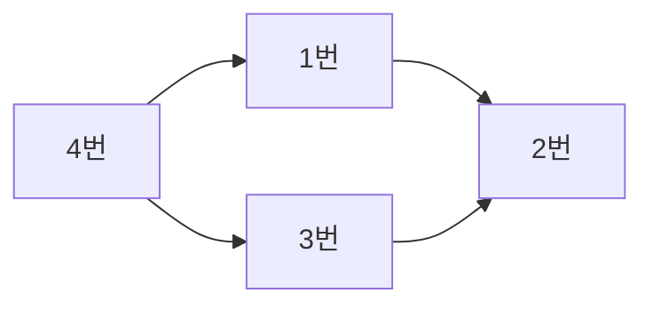
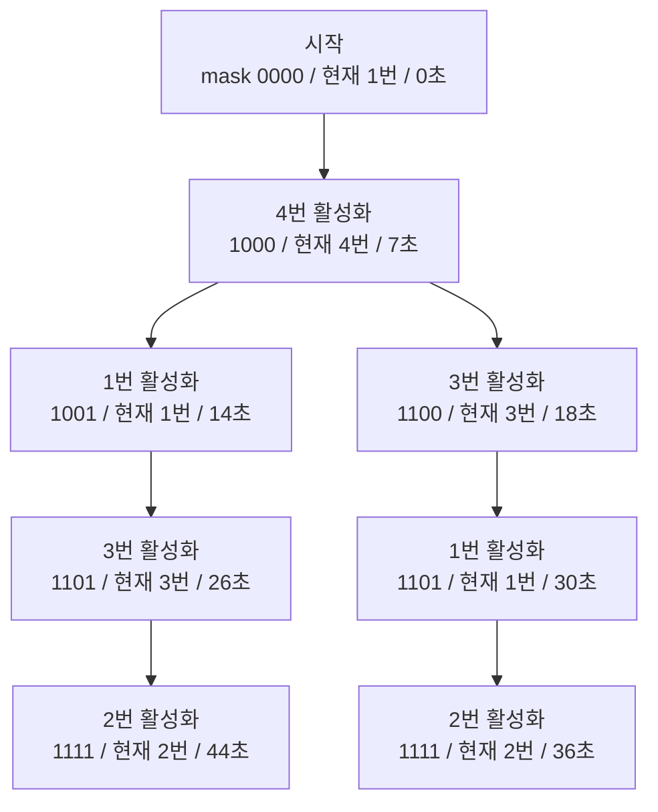

# 발전소 회로 복구 (프로그래머스 Lv.3)

- 문제 링크: https://school.programmers.co.kr/learn/courses/30/lessons/468375

## 0. 문제 요약

1번 패널의 **위치**에서 출발해 모든 패널을 안전 순서에 맞게 활성화하는 최소 시간을 구한다. 건물은 여러 층이지만 각 층의 `grid` 구조는 같다. 한 칸을 걸으면 1초, 엘리베이터로 한 층 이동하면 1초가 든다. 패널 `k`개는 최대 15개다.

안전 순서 `[a, b]`는 **a를 켜야 b를 켤 수 있다**는 뜻이다. 1번 위치에서 출발해도 1번 패널의 선행 조건이 남아 있다면 그 자리에서 바로 켤 수 없다.

## 사용 알고리즘 / 핵심 기법 / 자료구조

| 구분 | 이 문제에서의 역할 |
| --- | --- |
| 알고리즘: BFS | 격자에서 패널과 엘리베이터 사이의 최단 도보 시간을 구한다. |
| 탐색 방식: DFS | 지금 켤 수 있는 패널을 하나씩 선택해 가능한 활성화 순서를 탐색한다. |
| 핵심 기법: 비트마스크와 상태 가지치기 | 켠 패널 집합을 `mask`로 표현하고, 같은 `(mask, current)`에 더 늦게 도착하면 탐색을 멈춘다. |
| 핵심 기법: 선택 후 복구 | 패널을 켤 때 `indegree`를 줄이고, 다른 선택을 시험하기 전에 되돌린다. |
| 자료구조: `graph`, `indegree`, `Queue`, 배열 | 선행 관계, 격자 BFS, 이동 거리와 탐색 상태를 각각 관리한다. |

## 1. 문제 접근

처음에는 `grid`를 `char[][]`로 만들고, `seqs`의 `[a,b]`를 `graph[a] → b`와 `indegree[b]++`로 기록했다. 여기까지는 안전 순서를 표현하는 올바른 출발점이다. 다만 `Queue<Integer> q`로 위상정렬을 한 번 수행하면 **가능한 순서 하나**를 얻을 뿐이다. 같은 안전 조건을 지키는 여러 순서는 이동 시간이 다를 수 있으므로, 순서 하나만 선택해서는 최소 시간을 보장하지 못한다.

그래서 `graph`와 `indegree`는 유지하고, DFS의 각 단계에서 **아직 켜지 않았으며 `indegree == 0`인 모든 패널**을 다음 후보로 시도한다. 한 후보를 켠 뒤 그 후보를 선행 조건으로 기다리던 패널들의 `indegree`를 줄인다. 재귀 호출에서 돌아오면 다시 늘려서 다른 후보도 같은 이전 상태에서 시험한다. 이 코드는 위상정렬 큐를 실행하지 않는다.

선택 순서마다 필요한 이동 시간을 빠르게 더하려면, 먼저 모든 패널 사이의 이동 시간을 계산해 두어야 한다.

```text
같은 층: from 패널에서 BFS → to 패널 좌표까지의 거리
다른 층: from 패널 → 엘리베이터까지 걷기
       + 층 차이만큼 엘리베이터 타기
       + 엘리베이터 → to 패널까지 걷기
```

`grid`가 모든 층에서 같으므로 2차원 격자에서 각 패널 좌표를 출발점으로 BFS를 실행하면 된다. `walking`은 **현재 `from` 패널 하나에서 출발한 임시 거리표**다. 다음 `from`으로 넘어가기 전에 필요한 값을 `distance[from][to]`에 저장한다. 같은 층의 거리는 `walking`에서 바로 꺼내 `distance`에 넣으므로 `sameFloor` 배열은 필요 없다.

## 2. 문제 코드

```java
import java.util.*;

class Solution {
    private static final int INF = 1_000_000_000;
    private static final int[] DR = {1, -1, 0, 0};
    private static final int[] DC = {0, 0, 1, -1};

    private Map<Integer, List<Integer>> graph;
    private int[] indegree;
    private int[][] distance;
    private int[][] bestAtState;
    private int k;
    private int answer;

    public int solution(int h, String[] grid, int[][] panels, int[][] seqs) {
        int rows = grid.length;
        int cols = grid[0].length();
        char[][] map = new char[rows][cols];
        int elevatorR = -1;
        int elevatorC = -1;

        for (int r = 0; r < rows; r++) {
            char[] line = grid[r].toCharArray();
            for (int c = 0; c < line.length; c++) {
                map[r][c] = line[c];
                if (map[r][c] == '@') {
                    elevatorR = r;
                    elevatorC = c;
                }
            }
        }

        k = panels.length;
        graph = new HashMap<>();
        indegree = new int[k + 1];
        for (int[] s : seqs) {
            graph.putIfAbsent(s[0], new ArrayList<>());
            graph.get(s[0]).add(s[1]);
            indegree[s[1]]++;
        }

        distance = new int[k + 1][k + 1];
        int[] toElevator = new int[k + 1];

        for (int from = 1; from <= k; from++) {
            int startR = panels[from - 1][1] - 1;
            int startC = panels[from - 1][2] - 1;
            int[][] walking = bfs(map, startR, startC);
            toElevator[from] = walking[elevatorR][elevatorC];

            for (int to = 1; to <= k; to++) {
                if (panels[from - 1][0] != panels[to - 1][0]) continue;
                int targetR = panels[to - 1][1] - 1;
                int targetC = panels[to - 1][2] - 1;
                distance[from][to] = walking[targetR][targetC];
            }
        }

        for (int from = 1; from <= k; from++) {
            for (int to = 1; to <= k; to++) {
                int fromFloor = panels[from - 1][0];
                int toFloor = panels[to - 1][0];
                if (fromFloor == toFloor) continue;
                distance[from][to] = toElevator[from]
                    + Math.abs(fromFloor - toFloor)
                    + toElevator[to];
            }
        }

        bestAtState = new int[1 << k][k + 1];
        for (int[] row : bestAtState) Arrays.fill(row, INF);
        answer = INF;
        dfs(0, 1, 0);
        return answer;
    }

    private int[][] bfs(char[][] map, int sr, int sc) {
        int rows = map.length;
        int cols = map[0].length;
        int[][] dist = new int[rows][cols];
        for (int[] row : dist) Arrays.fill(row, -1);

        Queue<int[]> q = new ArrayDeque<>();
        q.offer(new int[]{sr, sc});
        dist[sr][sc] = 0;

        while (!q.isEmpty()) {
            int[] cur = q.poll();
            int r = cur[0];
            int c = cur[1];

            for (int d = 0; d < 4; d++) {
                int nr = r + DR[d];
                int nc = c + DC[d];
                if (nr < 0 || nr >= rows || nc < 0 || nc >= cols) continue;
                if (map[nr][nc] == '#' || dist[nr][nc] != -1) continue;
                dist[nr][nc] = dist[r][c] + 1;
                q.offer(new int[]{nr, nc});
            }
        }
        return dist;
    }

    private void dfs(int mask, int current, int time) {
        if (time >= answer || time >= bestAtState[mask][current]) return;
        bestAtState[mask][current] = time;

        if (mask == (1 << k) - 1) {
            answer = time;
            return;
        }

        for (int next = 1; next <= k; next++) {
            int bit = 1 << (next - 1);
            if ((mask & bit) != 0 || indegree[next] != 0) continue;
            if (distance[current][next] == -1) continue;

            List<Integer> afterList = graph.getOrDefault(next, Collections.emptyList());
            for (int after : afterList) indegree[after]--;

            dfs(mask | bit, next, time + distance[current][next]);

            for (int after : afterList) indegree[after]++;
        }
    }
}
```

### 코드 구현 흐름

| 순서 | 함수·코드 | 역할 |
| --- | --- | --- |
| 1 | `solution()`의 격자 복사 | `grid`를 `char[][]`로 만들고 `@`의 좌표를 찾는다. 패널의 행·열은 1부터 시작하므로 BFS에 전달할 때 1을 뺀다. |
| 2 | `graph`, `indegree` 구성 | `[a,b]`를 `a → b`로 저장하고 `b`의 남은 선행 조건 수를 늘린다. |
| 3 | `bfs()` | 한 패널의 좌표에서 모든 칸까지의 최단 도보 시간을 구한다. `#`은 지나갈 수 없다. |
| 4 | `distance` 구성 | 같은 층은 `walking`의 값, 다른 층은 양쪽의 엘리베이터 도보 시간과 층 차이를 합한다. |
| 5 | `bestAtState` 초기화 | 방문한 적 없는 상태를 `INF`로 표시한다. |
| 6 | `dfs(0, 1, 0)` | 1번 패널 **위치**에서, 아무 패널도 켜지 않은 상태로 시작한다. |
| 7 | `dfs()`의 후보 검사 | 아직 안 켠 패널 중 선행 조건이 모두 충족된 패널만 선택한다. |
| 8 | `dfs()`의 `indegree--`, `indegree++` | 이번 선택이 다음 패널들에 미치는 효과를 적용하고, 탐색 후 복구한다. |
| 9 | `dfs()`의 종료 조건 | 모두 켠 `mask`에 도착한 시간을 정답으로 기록한다. |

## 3. 예시 1로 선행 관계와 비트마스크 따라가기

패널이 **4개이고 정답이 36초인 입출력 예시 1**을 사용한다. 패널 번호는 `panels` 배열의 순서와 같다.

```text
1번: 2층 (3행, 4열)   2번: 2층 (5행, 6열)
3번: 1층 (1행, 1열)   4번: 3층 (6행, 3열)
seqs = [[3,2], [1,2], [4,1], [4,3]]
```

### 선행 관계 그림: `graph`와 `indegree`



처음 `indegree`는 `1번=1`, `2번=2`, `3번=1`, `4번=0`이다. 따라서 **시작 위치는 1번이지만 처음 켤 수 있는 패널은 4번뿐**이다. 4번을 켜면 1번과 3번의 `indegree`가 0이 된다. 어느 쪽을 먼저 켜느냐에 따라 이동 시간이 달라진다.

### 비트 위치 그림: `1 << k`와 `1 << (next - 1)`

```text
왼쪽부터 비트가 가리키는 패널:  [4번] [3번] [2번] [1번]
한 패널을 켰을 때의 비트:      1000  0100  0010  0001
아직 아무것도 안 켠 mask:                 0000
모두 켠 mask:                            1111
```

4번 패널을 켤 때의 `bit`는 `1 << (4 - 1) = 1000₂ = 8`이다. `1 << k = 1 << 4 = 10000₂ = 16`은 **패널 4번의 비트가 아니라 `bestAtState` 배열에 필요한 첫 번째 크기**다. `mask`는 `0000₂=0`부터 `1111₂=15`까지 16가지이므로 `new int[16][5]`로 만든다. 두 번째 크기 5는 `current`에 패널 번호 1~4를 그대로 쓰기 위해서다.

```text
  10000₂ (= 16, 배열 크기)
- 00001₂
= 01111₂ (= 15, 모두 켠 mask)
```

따라서 `mask == (1 << k) - 1`은 **모든 패널이 켜졌는가?**를 확인하는 종료 조건이다. `bestAtState[mask][current]`에는 해당 상태까지 걸린 가장 짧은 시간을 저장한다. 예를 들어 `bestAtState[8][4]=7`은 **4번만 켜고 4번 위치에 7초 만에 도착했다**는 뜻이다.

### 이동 거리와 DFS 그림

예시의 `distance[from][to]`는 다음과 같다. 같은 층은 BFS 결과이고, 층이 다르면 엘리베이터를 거친 시간이다. 예를 들어 `distance[1][4] = 4 + 1 + 2 = 7`이다.

| `from` → `to` | 1번 | 2번 | 3번 | 4번 |
| ---: | ---: | ---: | ---: | ---: |
| **1번** | 0 | 6 | 12 | 7 |
| **2번** | 6 | 0 | 18 | 13 |
| **3번** | 12 | 18 | 0 | 11 |
| **4번** | 7 | 13 | 11 | 0 |



`for (next=1; next<=k; next++)`라서 4번을 켠 다음 1번을 먼저 시도한다. `4 → 1 → 3 → 2`는 44초이므로 처음에는 `answer=44`다. 돌아와 `indegree`를 복구하고 `4 → 3 → 1 → 2`를 시도하면 36초가 나와 `answer=36`으로 갱신된다.

| 호출 | `mask`의 십진수 | `current` | `time` | 기록 |
| --- | ---: | ---: | ---: | --- |
| 출발 | 0 | 1 | 0 | `bestAtState[0][1]=0` |
| 4번 활성화 | 8 | 4 | 7 | `bestAtState[8][4]=7` |
| 4→1→3 | 13 | 3 | 26 | `bestAtState[13][3]=26` |
| 4→1→3→2 | 15 | 2 | 44 | `bestAtState[15][2]=44`, `answer=44` |
| 4→3→1 | 13 | 1 | 30 | `bestAtState[13][1]=30` |
| 4→3→1→2 | 15 | 2 | 36 | `bestAtState[15][2]=36`, `answer=36` |

두 경로의 `mask=1101₂=13`은 같다. 하지만 한 경로는 **3번 위치**, 다른 경로는 **1번 위치**에 있다. 2번으로 갈 때의 거리가 각각 `18`과 `6`이므로 `current`까지 상태에 포함해야 한다. 반대로 `mask`와 `current`가 모두 같은 상태에 이전보다 늦게 도착했다면 남은 선택도 같으므로 `bestAtState`를 보고 탐색을 멈춘다.

## 4. 새롭게 배운 내용

### `walking`과 `distance`는 무엇이 다른가?

`bfs(map, startR, startC)`가 반환한 `walking[r][c]`는 **이번 `from` 패널 하나**에서 격자의 `(r,c)`까지 걸리는 시간이다. 반복문이 다음 `from`으로 넘어가면 새 BFS 결과가 `walking`에 들어온다. 그래서 같은 층의 패널 좌표까지 걸리는 시간을 그때 `distance[from][to]`에 저장한다. `distance`는 모든 패널 쌍의 이동 시간을 모은 표이고, DFS는 이 표의 값만 읽는다.

### 왜 `indegree`를 되돌리는가?

4번을 켠 경우에는 1번과 3번의 `indegree`를 줄인다. `4→1→3→2` 탐색을 끝낸 뒤에도 줄어든 값을 그대로 두면 `4→3→1→2`를 **같은 이전 조건**에서 시험할 수 없다. 따라서 각 DFS 분기에서 줄인 횟수만큼 돌아와 다시 늘린다. `mask`는 다음 호출에 새 정수 값으로 전달하므로 복구할 필요가 없다.

### `bestAtState`는 언제 가지치기하는가?

`bestAtState[mask][current]`는 이전에 그 상태에 도착한 최소 시간이다. 새 경로의 `time`이 그 값 이상이면, 같은 패널을 켰고 위치도 같은 상태에서 더 늦게 출발하는 셈이다. 앞으로 켤 수 있는 패널 역시 같은 `mask`로 결정되므로 탐색을 중단한다. `time >= answer`라면 이동 시간이 음수가 될 수 없으므로 더 좋은 최종 답을 만들 수도 없다.

## 5. 처음 보는 문제에서의 사고 흐름

| 문제의 문장·조건 | 먼저 할 질문 | 코드로 옮길 것 |
| --- | --- | --- |
| 모든 층의 격자 구조가 같음 | 같은 층에서 두 위치 사이 최단 거리를 어떻게 구할까? | 2차원 `grid`에서 각 패널 위치를 시작점으로 BFS |
| 층을 바꿀 때 반드시 엘리베이터 | 다른 층 패널까지 이동 시간을 어떻게 나눌까? | 양쪽 엘리베이터 도보 거리 + 층 차이 |
| `[a,b]`는 a를 먼저 켜야 함 | 지금 어떤 패널을 켤 수 있나? | `graph[a]`와 `indegree[b]`로 선행 조건 관리 |
| 모든 패널을 켜는 최소 시간 | 가능한 안전 순서가 하나뿐인가? | DFS로 모든 가능한 다음 패널을 시도 |
| 패널 수 `k ≤ 15` | 켠 패널 집합을 작게 표현할 수 있나? | `k`비트 `mask`와 `current`로 상태 표시 |
| 같은 상태에 여러 경로로 도착 가능 | 이전보다 늦게 온 경로도 계속 볼까? | `bestAtState[mask][current]`로 가지치기 |


## 6. 위상정렬 큐 없이 선행 조건 검사하기

이 문서의 최종 코드는 `graph`와 `indegree`를 사용하지만, **큐에서 위상정렬 순서 하나를 뽑지는 않는다**. DFS에서 `indegree[next] == 0`인 패널을 후보로 삼아 가능한 안전 순서를 각각 확인한다.

`graph`·`indegree` 자체도 없애고 싶다면, **각 패널을 켜기 전에 필요한 패널들**을 `required`라는 비트마스크로 저장할 수 있다. 예시 1의 `seqs`는 `[[3,2], [1,2], [4,1], [4,3]]`이다.

```java
int[] required = new int[k + 1];
for (int[] s : seqs) {
    required[s[1]] |= 1 << (s[0] - 1);
}
```

`[3,2]`를 읽으면 `required[2]`의 3번 비트 `0100`을 켠다. `[1,2]`까지 읽으면 1번 비트 `0001`도 켜져 `required[2]=0101`이 된다. `|=`는 기존에 켜 둔 비트를 유지하면서 새 비트를 추가한다.

| 켜려는 패널 `next` | 먼저 켜야 하는 패널 | `required[next]` (`[4][3][2][1]`) |
| ---: | --- | --- |
| 1 | 4번 | `1000` |
| 2 | 1번, 3번 | `0101` |
| 3 | 4번 | `1000` |
| 4 | 없음 | `0000` |

### `(mask & required[next]) != required[next]` 읽기

`mask`는 **이미 켠 패널**, `required[next]`는 **next를 켜려면 필요한 패널**이다. `&`를 하면 양쪽에서 모두 켜진 비트만 남는다. 그 결과가 `required[next]`와 같으면 필요한 패널이 전부 `mask`에 들어 있다.

```text
4번만 켠 상태에서 2번을 켜려는 경우
이미 켠 패널 mask:          1000
2번의 선행 조건 required[2]: 0101  (1번과 3번 필요)
두 값을 &:                  0000  ≠ 0101 → 아직 못 켬

4번, 3번, 1번을 켠 뒤 2번을 켜려는 경우
이미 켠 패널 mask:          1101
2번의 선행 조건 required[2]: 0101
두 값을 &:                  0101  = 0101 → 이제 켤 수 있음
```

그래서 DFS에서 아래처럼 검사한다. **서로 다르면 필요한 선행 패널이 하나 이상 아직 꺼져 있다**는 뜻이므로 `continue`로 다음 후보를 확인한다.

```java
for (int next = 1; next <= k; next++) {
    int bit = 1 << (next - 1);
    if ((mask & bit) != 0) continue; // next는 이미 켜져있다는 뜻. mask 1001 & bit 1000 = 1000
    if ((mask & required[next]) != required[next]) continue; // 선행 조건 미충족
    if (distance[current][next] == -1) continue;

    dfs(mask | bit, next, time + distance[current][next]);
}
```

이 대안에서는 `graph`와 `indegree`를 만들지 않는다. 따라서 최종 코드에 있던 `graph.getOrDefault(next, ...)`, `indegree[next]` 검사, `indegree[after]--`와 `indegree[after]++`도 **모두 제거**한다. `required`는 탐색 중 바뀌지 않고, `mask`는 재귀 호출마다 새 정수로 전달되므로 선행 조건을 복구할 코드가 필요 없다. BFS로 구한 `distance`, `bestAtState`, 정답 갱신은 그대로 사용한다.